# AGROSHIFT AI — BİLİMSEL VERİ MİMARİSİ VE VERİTABANI ŞEMASI (`DATA_ARCHITECTURE.md`)

Bu belge, AgroShift AI'nin uçtan uca tarımsal bilimsel veri boru hattını (*Data Pipeline*), PostgreSQL + PostGIS ilişkisel/mekânsal veritabanı şemasını ([sql/schema.sql](file:///c:/Users/omerm/Desktop/NASA%20Space%20Apps%20Challenge%202026%20-%20Kopya/agroshift/sql/schema.sql)), Python veri işleme paketini ([data_pipeline/](file:///c:/Users/omerm/Desktop/NASA%20Space%20Apps%20Challenge%202026%20-%20Kopya/agroshift/data_pipeline/__init__.py)) ve Next.js TypeScript veri altyapısı katmanını ([src/lib/data-infra/](file:///c:/Users/omerm/Desktop/NASA%20Space%20Apps%20Challenge%202026%20-%20Kopya/agroshift/src/lib/data-infra/repository.ts)) açıklar.

---

## 1. Uçtan Uca Veri Akış Mimarisi

```mermaid
flowchart LR
    DS["1. Veri Kaynakları (NASA, ISRIC, FAO, TÜİK, MGM, TMO)"] --> ING["2. Ingestion & Polite Queue (Rate-Limit & Exponential Backoff)"]
    ING --> RAW["3. Raw Storage & Snapshots (datasets / JSON / HDF5)"]
    RAW --> VAL["4. Kalite & Fiziksel Sınır Doğrulama (quality.ts / validators.py)"]
    VAL --> HARM["5. Uzamsal & Birim Harmonizasyon (EPSG:4326, d_factor, Lab Önceliği)"]
    HARM --> FEAT["6. Özellik Mühendisliği (FAO-56 ET0, Saxton-Rawls, GDD, Anomaliler)"]
    FEAT --> MOD["7. Bilimsel Modeller (Günlük Kök Bölgesi Su Dengesi & Ky / WP*)"]
    MOD --> OPT["8. Çok Amaçlı Optimizasyon (3 Yıllık Rotasyon, Pareto, Minimax Regret)"]
    OPT --> API["9. REST API Katmanı (/api/data/*, /api/fields/*, /api/crops/*)"]
    API --> UI["10. Anadolu Tarımsal Komuta Merkezi (Harita & Kanıt Kartları)"]
```

---

## 2. Veritabanı Şeması (18 Mantıksal Tablo — PostgreSQL 15+ / PostGIS 3+)

Tam DDL tanımı [sql/schema.sql](file:///c:/Users/omerm/Desktop/NASA%20Space%20Apps%20Challenge%202026%20-%20Kopya/agroshift/sql/schema.sql) dosyasındadır. Tüm gözlem ve parametre tabloları kaynak izlenebilirliği (*provenance*), zaman damgaları (`observation_date` / `retrieved_at`), koordinat/geometri (`EPSG:4326`), çözünürlük (`spatial_resolution_m`), birim (`units_json`), kalite bayrağı (`quality_flag`) ve doğrulama durumu (`verification_status`: `'Verified' | 'Estimated' | 'Unavailable'`) sütunlarını içerir.

| # | Tablo Adı | Birincil Anahtar / Tekillik Kısıtı (`UNIQUE`) | Açıklama ve Rolü |
|---|---|---|---|
| 1 | `data_sources` | `PK (source_id)` | 12 bilimsel/resmî veri kaynağının uç noktaları, çözünürlükleri, lisansları ve yenileme politikaları. |
| 2 | `ingestion_jobs` | `PK (job_id)`, `UNIQUE (idempotency_key)` | Otomatik ve manuel veri çekme işlerinin denetim kaydı (çekilen, eklenen, güncellenen, reddedilen satır sayıları ve HTTP durum kodları). |
| 3 | `datasets` | `PK (dataset_id)` | Ham veri sürümleri, SHA-256 sağlama toplamları ve depolama URI referansları. |
| 4 | `field_boundaries` | `PK (field_id)`, `GIST (geom)` | `WGS84 (EPSG:4326)` `MultiPolygon` parsel sınırları, eşit-alan (*authalic*) dekar/hektar alanı, eğim ve sensör piksel örtüşme analizleri. |
| 5 | `weather_daily` | `UNIQUE (field_id, source_id, observation_date)` | NASA POWER günlük meteoroloji serisi (`T2M`, `T2M_MAX`, `T2M_MIN`, `PRECTOTCORR`, `RH2M`, `WS2M`, `ALLSKY_SFC_SW_DWN`) ve FAO-56 $ET_0$. |
| 6 | `precipitation_observations` | `UNIQUE (field_id, source_id, temporal_granularity, period_start, period_end)` | NASA POWER, GPM IMERG, ECMWF ERA5 ve MGM 1991–2020 yağış gözlemleri, normalleri ve yüzde anomalileri. |
| 7 | `soil_moisture_observations` | `UNIQUE (field_id, source_id, observation_date)` | NASA SMAP L4 (0–5 cm yüzey, 0–100 cm kök bölgesi) ve MERRA-2 toprak ıslaklığı (`is_parcel_scale_sensor = FALSE`). |
| 8 | `vegetation_indices` | `UNIQUE (field_id, source_id, composite_date)` | Bulut filtreli MODIS `MOD13Q1` 250 m 16 günlük NDVI/EVI serisi ve fenolojik evre ipuçları. |
| 9 | `soil_properties` | `UNIQUE (field_id, data_origin, depth_top_cm, depth_bottom_cm)` | 6 derinlik katmanında (`0–200 cm`) toprak özellikleri; `user_lab` (`priority_rank=1`) ve `soilgrids_v2` (`priority_rank=2`) ayrı saklanır. |
| 10 | `crop_parameters` | `PK (crop_id)` | 12 ürün için FAO-56 ($K_c, Z_r, p$), FAO-33/66 ($K_y$) ve FAO AquaCrop v7.1 ($WP^*, HI_0, CGC, CDC$) parametreleri. |
| 11 | `crop_history` | `UNIQUE (field_id, agricultural_year)` | Parselin geçmiş yıllardaki ürün dizisi ve sulama yönetim rejimi. |
| 12 | `crop_yields` | `UNIQUE (source_id, crop_id, province, reference_year, production_regime)` | TÜİK 2024–2025 il/ülke bazlı sulu ve kuru tarım referans verimleri ($\text{kg/da}$ ve $\text{t/ha}$) ile toplam rekolteler. |
| 13 | `market_prices` | `UNIQUE (source_id, crop_id, marketing_season, pricing_authority)` | TMO, Trakya Birlik, Türkşeker ve Ticaret Borsaları 2025/2026 alım fiyatları ($\text{TL/kg}$). |
| 14 | `production_costs` | `UNIQUE (source_id, crop_id, season, region_scope)` | Sulu/kuru değişken üretim maliyetleri ve Tarım Bakanlığı 2025–2027 Yeni Destekleme Modeli tutarları ($\text{TL/da}$). |
| 15 | `irrigation_records` | `UNIQUE (field_id, agricultural_year)` | Parsel su bütçesi ($\text{mm/yıl} = \text{m}^3\text{/da/yıl}$), sulama yöntemi randımanı ve DSİ su kısıtı havza durumu. |
| 16 | `climate_scenarios` | `PK (scenario_id)` | NASA NEX-GDDP-CMIP6 `SSP2-4.5` ve `SSP5-8.5` bölgesel sıcaklık ($\Delta T$) ve yağış çarpanları. |
| 17 | `model_inputs` | `PK (model_input_id)`, `UNIQUE (input_hash)` | Bilimsel simülasyon motoruna giren doğrulanmış özellik vektörünün SHA-256 kilitli anlık görüntüsü. |
| 18 | `model_outputs` | `PK (model_output_id)` | Simülasyon ve çok amaçlı rotasyon optimizasyonu çıktıları, güven derecesi (`A–D`) ve kanıt izleri. |

---

## 3. İdempotent Veri Yenileme ve Hata Toleransı

1. **İdempotensi Anahtarı (`idempotency_key`):** Her yenileme işi `SHA256(job_type | field_id | source_id | date_bucket)` anahtarı ile oluşturulur. Aynı gün içinde veya aynı veri penceresi için tekrar çalıştırılan yenileme işleri veritabanında mükerrer (*duplicate*) satır oluşturmaz; `ON CONFLICT DO UPDATE` mantığıyla mevcut kayıtları günceller.
2. **Nazik Kuyruk ve Üstel Geri Çekilme (*Polite Queue & Exponential Backoff*):** Dış API'lerin hız sınırlarını aşmamak için [src/lib/data/terrain.ts](file:///c:/Users/omerm/Desktop/NASA%20Space%20Apps%20Challenge%202026%20-%20Kopya/agroshift/src/lib/data/terrain.ts) ve [src/lib/data/http.ts](file:///c:/Users/omerm/Desktop/NASA%20Space%20Apps%20Challenge%202026%20-%20Kopya/agroshift/src/lib/data/http.ts) içinde seri hız sınırlayıcı kuyruk ve üstel geri çekilme uygulanır.
3. **Bozulmayan Geri Dönüş (*Non-Destructive Fallback*):** Canlı bir dış servis zaman aşımına uğrarsa veya kimlik doğrulama gerektirirse (`EARTHDATA_TOKEN` gibi), sistem mevcut doğrulanmış yerel anlık görüntüyü (*snapshot*) korur, hatayı `ingestion_jobs.error_message` alanına yazar ve hiçbir koşulda uydurma veri üretmez.
